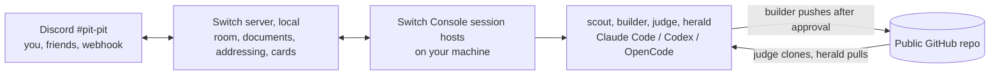

# Pit Crew

Pit Crew gives one person racing a deadline a crew of AI agent teammates in a
single Discord channel. The **scout** turns the event's rules (or an issue's
"Done when" list) into a live checklist and countdown and flags rule risks.
The **builder** works in your project and asks you on a card before it pushes
or does anything risky. The **judge** clones only what you pushed into an
empty folder and scores it against the rubric, as the real judges will; it
alone can call the work SHIP-READY. The **herald** turns commits into a build
log, README sections, blog and social drafts, and never publishes. Friends
can join the channel and talk to the crew; only you can direct the builder.
It is one [Switch](https://github.com/sandbox-quantum/switch) template. We
are using it on our own Flip the Switch entry, including our pull requests to
Switch itself; [evidence/](evidence/) holds what it has produced so far.

Demo video: TODO(video-link)

TODO(screenshot): the `#pit-pit` channel with the four agents, an approval
card and a judge verdict.

## The crew

| Agent | Does | Who can address it | Writes to your project |
|---|---|---|---|
| scout | Checklist and countdown on the `pit-board` room document; flags rule risks, quoting the rule | Anyone in the pit room | No |
| builder | Codes in your project folder; asks you on a card before pushes, dependency changes, secrets or spending money | You (and your agents) | Yes, the only one |
| judge | Clean-room clone of the public repo, `judge-kit/check.py`, the README's steps, a 1 to 10 score per rubric line, a report attached in the room | Anyone in the pit room | No |
| herald | Build log, README sections, blog draft, video script, social posts, all from the git history | Anyone in the pit room | No |

## How Switch is used (and why it breaks without it)

Pit Crew has no server or bot of its own. Everything it does is a Switch
feature, set up by [`pit-crew.template.yaml`](pit-crew.template.yaml):

| Pit Crew feature | Switch primitive | Without Switch |
|---|---|---|
| Four agents and a channel from one file | Version 2 template: four `type: agent` resources, one `type: room`, a kickoff | Four terminals set up by hand |
| Each agent on the coding agent you pick | `type: provider` params, each a fallback chain such as `[claude, codex, opencode]` | One vendor, or glue code per vendor |
| Only you direct the builder; friends can talk to the rest | `addressing: owner-agents` on the builder, `{anyone_in: [pit]}` on the others | Anyone in the chat could set the agent in your project to work, or nobody else could join |
| Approve a push from your phone | The builder's question tool becomes a card with buttons in Discord; who may press it follows the agent's addressing | Sit at the terminal, or let the agent push unchecked |
| Agents hand work to each other | `send_targeted_message` inside the room | Copy and paste between terminals |
| Shared checklist, scorecard and build log | Room documents (`create_room_document`, `update_room_document`, `load_internal_documents`), plus the template's `docs:` | Four contexts that drift apart |
| Reports and drafts land in the chat | `send_attachment` | Files nobody else sees |
| Git hooks and a scheduler can nudge agents | The Discord bridge relays third-party webhook posts into the room | No way in from outside |

## Architecture



The longer version, with how one request flows through the system and where
each secret lives, is in [docs/architecture.md](docs/architecture.md).

## Reproduce in about 30 minutes

You need: a computer running Windows, macOS or Linux; Node.js 20 or later
(Switch starts your agents with it; Console does not install it on your own
computer); a coding agent you are signed in to (Claude Code, Codex or
OpenCode); a Discord account; a public GitHub repository for the project you
are building, cloned locally.

1. **Get Pit Crew.**
   `git clone https://github.com/satanrayshe/pit-crew && cd pit-crew`
2. **Install Switch Console 0.40 or later** from the
   [Switch releases](https://github.com/sandbox-quantum/switch/releases)
   (on Windows, `switch-console-x64.exe`). Windows and Linux builds are in
   early access.
3. **Run a server.** In Console: Add a server, then **Run a server on this
   computer**. Console starts a local Switch server and signs you in. No
   Docker is needed (the event page still lists Docker; Switch's Add a
   server page says "No Docker needed").
4. **Check your agent.** Settings, Agent providers: your coding agent should
   show as installed and signed in.
5. **Connect Discord** (about 10 minutes): follow
   [docs/discord-setup.md](docs/discord-setup.md). Tick **Use for new rooms
   by default** when you connect, and link your Discord account.
6. **Import the template.** Templates, **Import template**, choose or drop
   `pit-crew.template.yaml`, **Import**, then save it in the dialog. On the
   template's page, select **Use template** and fill in:
   - **Crew name**: a new one for each run (agent names are unique on a
     server).
   - **Public repository** and **Project folder**: your repo and your local
     clone of it. Add `.switch/` and `.claude/settings.local.json` to that
     project's `.gitignore`; Console writes the builder's agent token there.
   - **Mission** and **Judging rubric**: for a first try, paste the two
     blocks from [rules/mini-hackathon.md](rules/mini-hackathon.md), set
     **What you are racing for** to `Mini hackathon` and the **Deadline**
     two hours ahead. For Flip the Switch, the defaults already hold
     [rules/flip-the-switch.md](rules/flip-the-switch.md) in short.
   - **Messaging app**: check that it shows your Discord connection.
   - Advanced: which coding agent runs each crew member.

   Select **Create all**.
7. **Kickoff.** A channel named `<crew>-pit` appears in Discord. The kickoff
   wakes the crew: the scout posts the pit board and countdown, the others
   say hello. Then try `@scout what is at risk?`, give the builder a small
   task and approve its push on the card, and ask `@judge review`.
8. **Optional: hooks.** Create a new webhook on the channel (step 8 of
   [docs/discord-setup.md](docs/discord-setup.md)), put its URL in `.env`
   (copy `.env.example`), then:
   - `scripts/install-commit-hook.sh <crew> <project folder>` tells the
     herald about every commit in that repository, the builder's included
     (the builder sees the hook and leaves the notice to it). On Windows:
     `powershell -ExecutionPolicy Bypass -File scripts\install-commit-hook.ps1 -Crew <crew> -Repository <project folder>`.
   - [scripts/heartbeat.md](scripts/heartbeat.md) sets up a pit check every
     two hours with cron or Task Scheduler.
   - `scripts/pit-post.sh "@<crew>-scout pit check"` posts once by hand.

To check the template without Console, run the server's own lint and planner
from a [Switch](https://github.com/sandbox-quantum/switch) checkout:

```sh
uv run --project <switch checkout>/core python scripts/validate-template.py pit-crew.template.yaml
```

Our output is in [evidence/template-lint.txt](evidence/template-lint.txt).

## The judge kit

`judge-kit/check.py` is what the judge runs on every clean clone. It needs
only Python 3.10+ and git, and prints JSON:

```sh
# a hackathon submission
python3 judge-kit/check.py path/to/clone

# a pull request's files only (clone without --depth 1, so there is a merge base)
git -C path/to/clone fetch <upstream repository URL> main
python3 judge-kit/check.py path/to/clone --mode hygiene --changed-since FETCH_HEAD
```

It checks the README for a "how Switch is used" section, reproduce steps, an
architecture diagram and a demo video link; a license; that every
`*.template.yaml` parses; secrets (Discord bot tokens and webhook URLs, GitHub,
OpenAI, Anthropic, AWS, Google and Slack keys, private keys, all redacted in
the output); committed `.env`, `.switch/` or `.claude/settings.local.json`
files; and files over 10 MB. Exit code 0 means every check passed. The tests
need pytest, and PyYAML for the template-parsing ones:
`uv run --with pytest --with pyyaml python -m pytest judge-kit`, or
`python3 -m pytest judge-kit` where both are installed. More in
[judge-kit/README.md](judge-kit/README.md).

## Using it on a pull request

Set the mission to the issue's "Done when" list and the public repository to
your fork. Ask `@judge judge branch <branch> of <fork URL> against issue
#<n>'s Done-when list`: it clones that branch with its history, fetches the
upstream base branch, runs the kit in hygiene mode on the changed files and
the project's own checks, and answers each Done-when item with met, not met
or not shown, with evidence.

## Evidence

[evidence/](evidence/) holds what the crew has produced so far: the
template's validation output and the judge kit's check of this repository.
Judge reports, pit-board snapshots and the build log go there as the crew
produces them. See [evidence/README.md](evidence/README.md) for what each
file is.

## How this was built

The heavy coding, for our Switch pull requests and for much of this
repository, happens in direct Claude Code sessions, not through the builder.
Pit Crew's part is the work around it: the checklist and countdown, a
clean-clone judgment of each push, the build log and the doc drafts.
Each file in the evidence folder says where it came from.

## Known limits

- Switch has no scheduler. Agents wake only when addressed. The scout
  recomputes the countdown from the clock on every wake, and the heartbeat is
  an outside cron job or scheduled task posting through a Discord webhook.
- Webhook posts reach the room as an app. They can address the scout, judge
  and herald (open to anyone in the room), never the builder. Check it once
  by hand before relying on the heartbeat.
- Anyone in the room can wake the scout, judge and herald and answer their
  approval cards. None of them writes to your project, but all three run
  commands on your machine, and the judge runs a cloned repository's
  install and test steps. Its instructions limit that to your repository,
  the judge kit and repositories you name yourself; that is a rule the agent
  follows, not one Switch enforces. Invite only people you would trust with
  that. Only you can direct the builder or answer its cards.
- Every time an agent creates or updates a room document, Switch posts a
  one-line notice in the channel ("updated room document build-log"), so
  each commit and each pit check adds a line.
- Telegram cannot create channels, and the template creates one. Use
  Discord, Slack or Mattermost.
- Only the agent that created a room document can update it, so the
  documents a template creates are read-only to agents. That is why the
  scout creates `pit-board` itself.
- A builder on Codex has no question forms (Codex only offers them in Plan
  mode), so it asks in the room instead of on a card. Approvals from the
  provider's own auto mode still arrive as cards.
- Four agents share one subscription and your coding agent's limits.
  `!follow-ups off` keeps unaddressed chatter from waking them;
  `!interrupt-all-agents` stops everyone.
- Rehearsals need a new crew name each time; archive old rooms rather than
  deleting them.
- The Windows and Linux builds of Console are in early access.

## Repository layout

```text
pit-crew.template.yaml   the template: four agents, one room, two documents, a kickoff
judge-kit/               check.py (stdlib only), its tests, its README
scripts/                 pit-post, install-commit-hook (sh and PowerShell), heartbeat.md,
                         validate-template.py (needs a Switch checkout)
rules/                   flip-the-switch.md (this event), mini-hackathon.md (a 2-hour trial)
docs/                    discord-setup.md, architecture.md, demo-script.md, blog-draft.md
assets/                  agent avatars (SVG sources, PNG for Discord)
evidence/                validation output, and what the crew produces as we use it
```

## License

[MIT](LICENSE), copyright 2026 satanrayshe.
