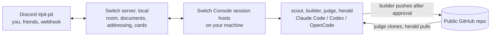

# Pit Crew

Pit Crew gives one person racing a deadline a crew of AI agent teammates in a
single Discord channel. The **scout** turns the event's rules (or an issue's
"Done when" list) into a live checklist and countdown and flags rule risks.
The **builder** works in your project and asks you on a card before it pushes
or does anything risky. The **judge** clones only what you pushed into an
empty folder and scores it against the rubric, as the real judges will; it
alone can call the work SHIP-READY. The **herald** turns commits into a build
log, README sections, blog and social drafts, and never publishes. Friends
can join the channel and talk to the crew; only you can direct the builder.
It is one [Switch](https://github.com/sandbox-quantum/switch) template. We
use it to run our own Flip the Switch entry, including our pull requests to
Switch itself, and the evidence folder fills up as we go.

Demo video: TODO(video-link)

TODO(screenshot): the `#pit-pit` channel with the four agents, an approval
card and a judge verdict.

## The crew

| Agent | Does | Who can address it | Writes to your project |
|---|---|---|---|
| scout | Checklist and countdown on the `pit-board` room document; flags rule risks, quoting the rule | Anyone in the pit room | No |
| builder | Codes in your project folder; asks you on a card before pushes, dependency changes, secrets or spending money | You (and your agents) | Yes, the only one |
| judge | Clean-room clone of the public repo, `judge-kit/check.py`, the README's steps, a 1 to 10 score per rubric line, a report attached in the room | Anyone in the pit room | No |
| herald | Build log, README sections, blog draft, video script, social posts, all from the git history | Anyone in the pit room | No |

## How Switch is used (and why it breaks without it)

Pit Crew has no server or bot of its own. Everything it does is a Switch
feature, set up by [`pit-crew.template.yaml`](pit-crew.template.yaml):

| Pit Crew feature | Switch primitive | Without Switch |
|---|---|---|
| Four agents and a channel from one file | Version 2 template: four `type: agent` resources, one `type: room`, a kickoff | Four terminals set up by hand |
| Each agent on the coding agent you pick | `type: provider` params with the chain `[claude, codex, opencode]` | One vendor, or glue code per vendor |
| Only you direct the builder; friends can talk to the rest | `addressing: owner-agents` on the builder, `{anyone_in: [pit]}` on the others | Anyone in the chat could run code on your laptop, or nobody else could join |
| Approve a push from your phone | The builder's question tool becomes a card with buttons in Discord; who may press it follows the agent's addressing | Sit at the terminal, or let the agent push unchecked |
| Agents hand work to each other | `send_targeted_message` inside the room | Copy and paste between terminals |
| Shared checklist, scorecard and build log | Room documents (`create_room_document`, `update_room_document`, `load_internal_documents`), plus the template's `docs:` | Four contexts that drift apart |
| Reports and drafts land in the chat | `send_attachment` | Files nobody else sees |
| Git hooks and a scheduler can nudge agents | The Discord bridge relays third-party webhook posts into the room | No way in from outside |

Remove Switch and you have four disconnected terminals: no shared room, no
approvals from your phone, no friends in the loop, nothing a stranger could
set up from one file.

## Architecture



The longer version, with how one request flows through the system and where
each secret lives, is in [docs/architecture.md](docs/architecture.md).

## Reproduce in 15 minutes

You need: a computer running Windows, macOS or Linux; a coding agent you are
signed in to (Claude Code, Codex or OpenCode); a Discord account; a public
GitHub repository for the project you are building, cloned locally.

1. **Install Switch Console 0.40 or later** from the
   [Switch releases](https://github.com/sandbox-quantum/switch/releases)
   (on Windows, `switch-console-x64.exe`). Windows and Linux builds are in
   early access.
2. **Run a server.** In Console: Add a server, then **Run a server on this
   computer**. Console starts a local Switch server and signs you in. No
   Docker is needed since Console 0.40.0 (changelog: "Run a local Switch
   server without Docker"), whatever older quickstart pages say.
3. **Check your agent.** Settings, Agent providers: your coding agent should
   show as installed and signed in.
4. **Connect Discord** (about 10 minutes): follow
   [docs/discord-setup.md](docs/discord-setup.md). Link your Discord account
   and mark the connection as the default for new rooms.
5. **Import the template.** Templates, **Import template**, drop in
   `pit-crew.template.yaml`. Fill in:
   - **Crew name**: a new one for each run (agent names are unique on a
     server).
   - **Public repository** and **Project folder**: your repo and your local
     clone of it. Add `.switch/` and `.claude/settings.local.json` to that
     project's `.gitignore`; Console writes the builder's agent token there.
   - **Deadline** and **Mission**: for a first try, paste the two blocks from
     [rules/mini-hackathon.md](rules/mini-hackathon.md) and set the deadline
     two hours ahead. For Flip the Switch, the defaults already hold
     [rules/flip-the-switch.md](rules/flip-the-switch.md) in short.
   - Advanced: which coding agent runs each crew member.

   Select **Create**.
6. **Kickoff.** A channel named `<crew>-pit` appears in Discord. The kickoff
   wakes the crew: the scout posts the pit board and countdown, the others
   say hello. Then try `@scout what is at risk?`, give the builder a small
   task and approve its push on the card, and ask `@judge review`.
7. **Optional: hooks.** Create a webhook on the channel, put its URL in
   `.env` (copy `.env.example`), then:
   - `scripts/install-commit-hook.sh <crew> <project folder>` (or
     `install-commit-hook.ps1`) tells the herald about commits you make
     outside the builder.
   - [scripts/heartbeat.md](scripts/heartbeat.md) sets up a pit check every
     two hours with cron or Task Scheduler.
   - `scripts/pit-post.sh "@<crew>-scout pit check"` posts once by hand.

To check the template without Console, run the server's own lint and planner
from a [Switch](https://github.com/sandbox-quantum/switch) checkout:

```sh
uv run --project <switch checkout>/core python scripts/validate-template.py pit-crew.template.yaml
```

Our output is in [evidence/template-lint.txt](evidence/template-lint.txt).

## The judge kit

`judge-kit/check.py` is what the judge runs on every clean clone. It needs
only Python 3.10+ and git, and prints JSON:

```sh
python3 judge-kit/check.py path/to/clone                  # a hackathon submission
python3 judge-kit/check.py path/to/clone --mode hygiene \
    --changed-since FETCH_HEAD                            # a pull request's files only
```

It checks the README for a "how Switch is used" section, reproduce steps, an
architecture diagram and a demo video link; a license; that every
`*.template.yaml` parses; secrets (Discord bot tokens and webhook URLs, GitHub,
OpenAI, Anthropic, AWS, Google and Slack keys, private keys, all redacted in
the output); committed `.env`, `.switch/` or `.claude/settings.local.json`
files; and files over 10 MB. Exit code 0 means every check passed. Tests:
`python -m pytest judge-kit`. More in [judge-kit/README.md](judge-kit/README.md).

## Using it on a pull request

Set the mission to the issue's "Done when" list and the public repository to
your fork. Ask `@judge judge branch <branch> of <fork URL> against issue
#<n>'s Done-when list`: it clones that branch, runs the kit in hygiene mode on
the changed files and the project's own checks, and answers each Done-when
item with met, not met or not shown, with evidence.

## Evidence

[evidence/](evidence/) holds what the crew produces while we use it for this
hackathon: the template's validation output, judge reports on this
repository and on our Track 03 pull requests, pit-board snapshots and the
build log. See [evidence/README.md](evidence/README.md) for what each file is.

## How this was built

The heavy coding, for our Switch pull requests and for much of this
repository, happens in direct Claude Code sessions, not through the builder.
Pit Crew runs around that work: it keeps the checklist and countdown, judges
each push from a clean clone, keeps the build log and drafts the docs. The
evidence folder says which parts came from the crew.

## Known limits

- **No scheduler in Switch.** Agents wake only when addressed. The scout
  recomputes the countdown from the clock on every wake, and the heartbeat is
  an outside cron job or scheduled task posting through a Discord webhook.
- **Webhook posts reach the room as an app.** They can address the scout,
  judge and herald (open to anyone in the room), never the builder. Check it
  once by hand before relying on the heartbeat.
- **Telegram cannot create channels**, and the template creates one. Use
  Discord, Slack or Mattermost.
- **Room documents a template creates are read-only to agents**: only the
  agent that created a document can update it. That is why the scout creates
  `pit-board` itself.
- **Approval cards follow addressing.** Anyone in the room can answer the
  scout's, judge's or herald's cards; none of them touches your project.
  Only you can answer the builder's.
- **Codex and Cursor sessions have no native question forms**, so a builder
  on Codex asks in the room instead of on a card. Approvals from the
  provider's own auto mode still arrive as cards.
- **One subscription, four agents.** They share your coding agent's limits.
  `!follow-ups off` keeps unaddressed chatter from waking them;
  `!interrupt-all-agents` stops everyone.
- **Rehearsals need a new crew name each time**, and archive old rooms
  rather than deleting them.
- **Windows and Linux builds of Console are early access.**

## Repository layout

```text
pit-crew.template.yaml   the template: four agents, one room, two documents, a kickoff
judge-kit/               check.py (stdlib only), its tests, its README
scripts/                 pit-post, install-commit-hook (sh and PowerShell), heartbeat.md,
                         validate-template.py (needs a Switch checkout)
rules/                   flip-the-switch.md (this event), mini-hackathon.md (a 2-hour trial)
docs/                    discord-setup.md, architecture.md, demo-script.md, blog-draft.md
assets/                  agent avatars (SVG sources, PNG for Discord)
evidence/                what the crew produced while we used it
```

## License

[MIT](LICENSE), copyright 2026 satanrayshe.
