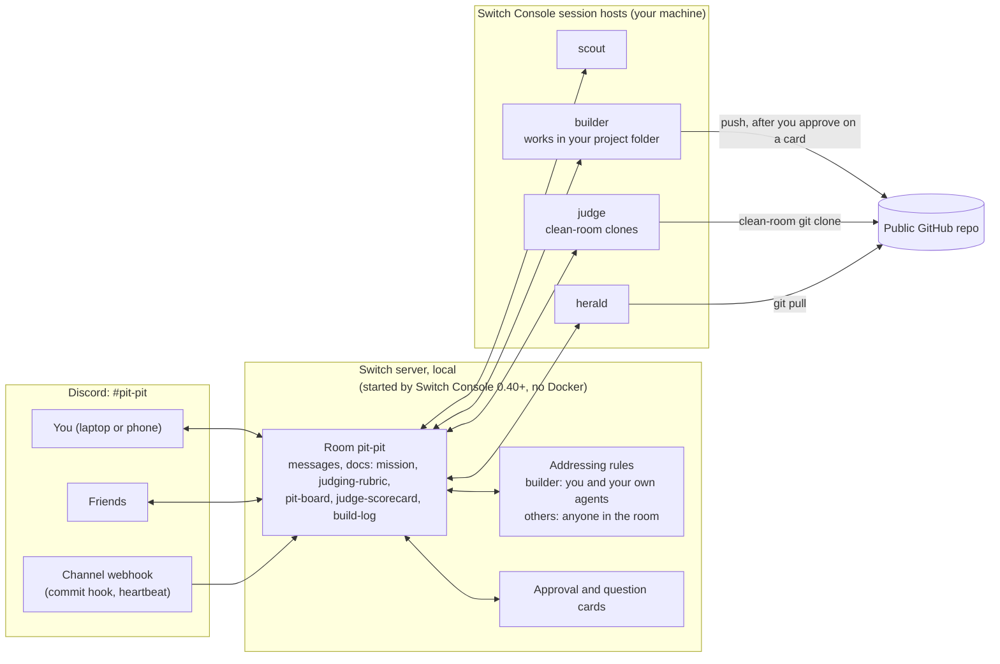

# Architecture

Pit Crew has no server of its own. It is one Switch template plus a few
scripts; everything that runs is Switch, Switch Console and the coding agents
you already use.

## How a request flows

1. You write `@builder add the commit hook script and push` in Discord. The
   Discord bridge relays it into the room, and the addressing rules check that
   the builder may take it: you are its owner.
2. Switch wakes the builder's session in Console (Claude Code, Codex or
   OpenCode, whichever the template resolved). It works in your project
   folder. Before `git push` it asks with its question tool, even though
   your message said to push; Switch turns that into a card with buttons in
   the chat app. Only you can answer it.
3. The builder sends a commit notice to the herald with
   `send_targeted_message` (the herald logs each hash once, so a commit
   hook's notice for the same commit adds nothing), and after the push a
   verify request to the judge. Those are agent-to-agent messages inside the
   room, checked by the same rules.
4. The judge clones the public repository into a fresh folder, runs
   `judge-kit/check.py` and the README's steps, and posts a verdict with the
   full report attached. It records the item and its answer in the mission
   table of the `judge-scorecard` room document, which has one row per
   checklist item on the scout's `pit-board` and no rows for the gate,
   scores or verdict.
5. Next time anyone addresses the scout (or the heartbeat does), it reads the
   scorecard and the build log, recomputes the countdown from the clock and
   updates the `pit-board` document, counting an item done only when its
   row in the scorecard's mission table says so.

## What Switch does here, and what would break without it

| Feature | Switch primitive | Without Switch |
|---|---|---|
| Four agents and one channel from one file | Version 2 template: four `type: agent` resources, a `type: room` resource, a kickoff | Four terminals to set up by hand, each with its own prompt, folder and provider |
| Each agent on the coding agent you choose | `type: provider` params, each a fallback chain such as `[claude, codex, opencode]` | One vendor, or glue code per vendor |
| The builder takes orders only from you; friends can still talk to the rest | `addressing: owner-agents` on the builder, `{anyone_in: [pit]}` on the others | Anyone in the chat could set the agent in your project to work, or nobody but you could join |
| Approve a push from your phone | Question tool to approval card with buttons in the chat app, answerable only by whoever may address the agent | Sitting at the terminal, or giving the agent free rein |
| Agents hand work to each other | `send_targeted_message` between agents in the room, under the same addressing rules | Copying output from one terminal into another |
| Shared memory: checklist, scores, build log | Room documents (`create_room_document`, `update_room_document`, `load_internal_documents`) and template `docs:` | Notes in four separate contexts that drift apart |
| Reports and drafts land in chat | `send_attachment` | Files on your disk that nobody else sees |
| Scripts can nudge agents | The Discord, Slack and Mattermost bridges relay incoming-webhook posts into the room | No way for git hooks or a scheduler to reach an agent |
| Each agent appears as itself | Per-agent `display_name` and `icon_url` (Discord webhooks, a Mattermost bot account per agent) | One bot speaking for everyone |
| Stop a runaway agent | `!interrupt @agent`, `!interrupt-all-agents`, the Stop button on a turn | Killing processes |

## Where things live

| Thing | Where |
|---|---|
| Bot token | Switch Console, in the Discord connection. Never in a file. |
| Webhook URL | `.env` in your pit-crew clone (ignored by git) |
| Agent API tokens | The agent controller's data folder (Console runs one for "Run managed agents on this computer"): `agents/<agent id>/credentials.json`, outside every agent's working directory. Agents added by hand in Console instead keep theirs in `.switch/agents/<agent>.json` in their folder, and some coding agents keep session files under `.switch/`, so `.switch/` belongs in the project's `.gitignore`. |
| Agent working folders | builder: your project folder. scout, judge, herald: their own folders under Console's agents directory. |
| Judge's clones | `clean-room-<UTC time>/` folders in the judge's own directory |
